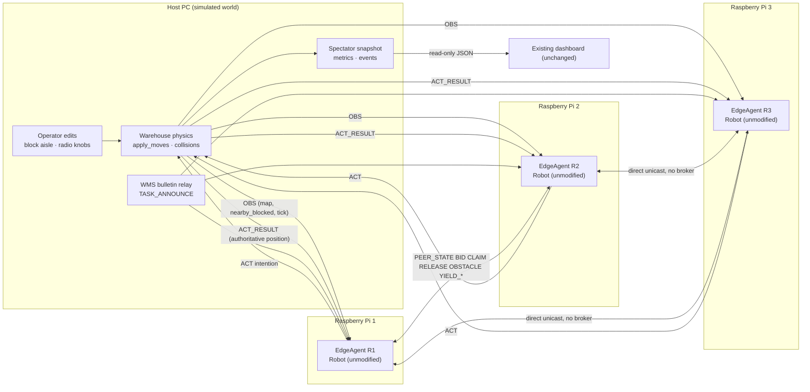

# 01 — Edge architecture: fleet decisions on three Raspberry Pis, world on the host

Goal: move the **decision stack** off the simulation host and onto independent edge nodes, while the
warehouse stays simulated. The existing `Robot` runs unmodified on each Pi; the host supplies
observations and applies the actions the robots themselves chose.

Non-goals: no engine rewrite, no central scheduler, no dashboard decision-making, no change to
`results/metrics.json`, and the deterministic in-process simulation remains the offline fallback.

---

## 1. Design constraints inherited from the problem statement

| Constraint | Architectural consequence |
| --- | --- |
| No central scheduler | the host never receives bids, never computes a winner, never plans a route. It is a *world*, not a *dispatcher* |
| Peer-to-peer messaging must be explicit | robots' messages go straight between agent sockets; the host is not a message broker for `PEER_STATE`/`BID`/`CLAIM`/`YIELD_*` |
| Don't rewrite the simulation engine | `FleetSim`, `Warehouse`, `PeerBus`, `Robot` are untouched. Edge code is additive under `simulation/edge/` and duck-types the two interfaces the robot already uses |
| Deterministic simulation stays available | `FleetSim` + `Dashboard` + `RUN_DEMO.bat` keep working exactly as they do today; edge mode is a separate entry point |
| Measured benchmark preserved | no file under `simulation/` that the benchmark imports is edited; test `T9` hashes `results/metrics.json` |

---

## 2. Topology

```
        ┌──────────────────────────────── demo LAN 192.168.50.0/24 ────────────────────────────────┐
        │                                                                                          │
   ┌────┴─────────────────┐            ┌──────────────┐      ┌──────────────┐    ┌──────────────┐
   │  HOST PC  .10        │            │  Pi #1 .11   │      │  Pi #2 .12   │    │  Pi #3 .13   │
   │  run_edge_host.py    │            │  R1          │      │  R2          │    │  R3          │
   │                      │            │              │      │              │    │              │
   │  WorldView (physics) │  OBS  ───► │ RemoteWorld  │      │ RemoteWorld  │    │ RemoteWorld  │
   │  Warehouse           │  :9201     │   View       │      │   View       │    │   View       │
   │  + operator edits    │  :9202  ─► │              │      │              │    │              │
   │  + WMS bulletins     │  :9203  ─► │ EdgeAgent    │      │ EdgeAgent    │    │ EdgeAgent    │
   │                      │            │  = Robot     │      │  = Robot     │    │  = Robot     │
   │  ACT :9100  ◄────────┼──────────  │  + tick loop │      │  + tick loop │    │  + tick loop │
   │  ACT_RESULT ────────►│            │              │      │              │    │              │
   │                      │            └──────┬───────┘      └──────┬───────┘    └──────┬───────┘
   │  spectator snapshot  │                   │  PEER_STATE / BID / CLAIM / RELEASE /  │
   │  (existing dash)     │                   │  OBSTACLE / YIELD_*  ⇄ direct unicast  │
   └──────────────────────┘                   └─────────────── UDP :9200+i ─────────────┘
                    │
                    │ websocket/HTTP (unchanged)
                    ▼
             existing browser dashboard  ──  renders snapshots only, decides nothing
```

Rendered version of the same picture: [`architecture_diagram.svg`](architecture_diagram.svg).

Mermaid version of the same picture (renders on GitHub):



---

## 3. Component map: in-process objects → distributed nodes

| Today (one process) | Edge equivalent | Responsibility moved? |
| --- | --- | --- |
| `Robot` (`robot.py`) | `EdgeAgent` on each Pi — the same `Robot` object plus a tick loop and a socket | **the decision stack moves to the edge** |
| `Warehouse` (`world.py`) | `EdgeHost` on the PC — physics, blocking, `apply_moves`, collision counting | stays on the host (simulated world, by requirement) |
| `Warehouse` as seen by a robot | `RemoteWorldView` (7 attributes, rebuilt from `OBS`) | sensing becomes explicit and network-shaped |
| `PeerBus` (`peer.py`) | `RemoteRadio` (real UDP) / `LoopbackRadio` (tests, parity) — same `broadcast`/`receive` contract | the medium becomes real; **no broker** |
| `FleetSim.step` loop (`engine.py:116`) | physics loop on the host; a *free-running* decision loop on each Pi | the loop is split in two, not centralized |
| `FleetSim._broadcast_task` / `_reannounce_unheard` | host relays `TASK_ANNOUNCE` on the peer channel as sender `WMS` | unchanged semantics: bulletin, never assignment |
| `FleetSim._auction_view`, `_sync_task_board` | host spectator bookkeeping, derived from what robots broadcast | read-only projection |
| `Dashboard` + `frontend/` | unchanged; can attach to an `EdgeHost` snapshot instead of a `FleetSim` | no new UI feature |

**Everything in the "decision" column stays on the Pis.** The host's column contains only physics,
timing, bulletin relay and measurement.

---

## 4. Authority boundary (the rule the whole design hangs on)

| The host MAY | The host MAY NOT |
| --- | --- |
| own the grid: walls, blocked cells, charger, turnouts | choose a task winner, at any time, for any reason |
| apply the intention each robot sent (or keep it in place) | invent, override or re-order a robot's intention |
| count collisions and record resulting positions | plan or repair a path, or reserve cells |
| compute `sense(pos, rng)` for the asking robot | arbitrate `YIELD_QUERY` or resolve a deadlock |
| relay `TASK_ANNOUNCE` as a bulletin (no addressing, no assignment) | claim, bid, or hold a task on a robot's behalf |
| publish the logical tick used as the shared time base | use that tick to sequence one robot ahead of another |
| expose a read-only snapshot and metrics | expose an endpoint that sets a winner/route/claim |

Enforcement, not just policy:

- `apply_moves` is called with `{robot_id: (x, y)}` and returns the new grid; the host has no code path
  that computes a destination (`T9`/`T8` static checks and behavioural tests in document 07).
- The host never opens a socket to a robot's peer port for anything other than `OBS`, `ACT_RESULT` and
  the WMS bulletin; peer traffic is unicast between Pis.
- The dashboard API accepts only the existing operator action list; unknown actions are ignored rather
  than reinterpreted (`dashboard.py:_apply`).

**Clock ≠ coordinator.** The host publishes the physics tick because move resolution needs one
authority for "simultaneous". Robots adopt it as their logical tick, because `robot.py` compares
`p.timestamp` against its own `tick` (`PEER_STALE_TICKS`, claim expiry) and those numbers must be
comparable. A tick is a clock, not a decision: the host never decides *who moves* and never uses the
tick to reorder robots — it applies whatever arrived by the deadline, in a deterministic order
(sorted robot ids), and reports back.

---

## 5. Tick and timing model

- **Physics tick:** the host advances one tick every `1 / TICK_HZ` = 125 ms (`config.TICK_HZ = 8`).
- **Decision pace:** each agent runs its own loop at the same nominal rate, but *free-running* — it does
  not wait for a lock-step ack in normal operation. Free-running is what makes the demo a real
  distributed system, and it is where packet loss, jitter and "I moved but the world says otherwise"
  become visible.
- **Shared logical clock:** every `OBS` carries `tick`. The agent sets `self.tick = max(self.tick, obs.tick)`
  (monotonic, never rewinds), so all nodes agree on the tick number within the LAN round-trip.
- **Intention deadline:** the host consumes the `ACT` messages that arrived for tick *N* before it runs
  `apply_moves` for tick *N*. A robot that misses the deadline is treated exactly like a robot that
  intended to stay (`"hold"`), and it receives an `ACT_RESULT` telling it the truth. No retry, no
  fallback plan — the robot's own `note_result` path handles the discrepancy.
- **Lock-step is the host's default.** `EdgeHost.step()` publishes `OBS(N)`, steps the agents for `ACT(N)`,
  applies, then publishes `OBS(N+1)`. With `LoopbackRadio` this is bit-identical to `FleetSim.step()`
  (same order of `bus.tick` → robot steps → `apply_moves` → `note_result`), which is what makes test
  `T1` an equality assertion rather than a "looks similar" check. There is no `lockstep=` flag: parity is
  the shipped loop-back behaviour, and free-running pacing is what the runner scripts' `--tick-hz` gives you.

Ordering proof sketch for parity (one tick, `FleetSim` vs lock-step edge):

| Step | `FleetSim.step()` | Edge (lock-step, loopback) |
| --- | --- | --- |
| 1 | `tick += 1`; operator block for this tick | host `tick += 1`; operator block, then `OBS(tick)` |
| 2 | `bus.tick(tick)` delivers messages sent at `tick-1` | agent drains `RemoteRadio.receive()` → messages sent at `tick-1` |
| 3 | `bot.step(tick)` per robot in id order | each agent calls `robot.step(tick)` |
| 4 | `world.apply_moves(intentions, tick)` | host `apply_moves(collected ACTs, tick)` |
| 5 | `bot.note_result(world.robots[id])` | `ACT_RESULT(tick, position)` → agent calls `note_result(pos)` before its next `step()` |

Step 5's placement is the subtle one: the agent applies the previous tick's result **before** the next
`step()`/`_ingest()`, which is exactly where `FleetSim` calls it today.

---

## 6. Code-level contracts

```python
# simulation/edge/worldview.py - the 7 members robot.py actually reads
class RemoteWorldView:                       # wire form, rebuilt from HELLO_WORLD + OBS
    width: int; height: int; walls: set[Pos]; turnouts: set[Pos]; charger: Pos
    def sense(self, pos: Pos, rng: int | None = None) -> set[Pos]   # range-filtered nearby_blocked
    def in_bounds(self, p: Pos) -> bool
    def apply_obs(self, obs: dict) -> None   # refresh the obstacle picture
    def apply_world(self, msg: dict) -> None # adopt new geometry on an env switch
class LocalWorldView:                        # live Warehouse, same 7 members (offline path)
    ...

# simulation/edge/radio.py - the 2 methods robot.py actually calls
class UdpRadio:          # real UDP; unicast to the peer table, allow-listed host address
    def broadcast(self, sender: str, msg: dict, tick: int) -> None
    def receive(self, robot_id: str) -> list[dict]
class LoopbackRadio:     # in-process, delay/queue-identical to PeerBus over a SharedMedium
    ...
class SharedMedium:      # the air: delay + drop_prob with PeerBus's RNG semantics
    ...

# simulation/edge/agent.py - Robot + socket + loop
class EdgeAgent:
    robot: Robot                                  # unmodified simulation.robot.Robot
    def install(self) -> Robot | None              # build the Robot once view+pos are known
    def tick_once(self, tick: int) -> dict | None  # decide; returns the ACT payload (the intention)
    def on_result(self, res: dict) -> None         # robot.note_result(authoritative pos)
    def deliver_datagrams(self, parts: list[bytes]) -> int
    def heartbeat(self, tick: int) -> dict

# simulation/edge/host.py - physics + relay + spectator, never a chooser
class EdgeHost:
    def step(self) -> None                     # OBS -> collect ACTs -> apply -> ACT_RESULT -> bulletins
    def collect_actions(self) -> dict[str, dict]   # hold-by-default on a missing/stale ACT
    def apply(self, intentions: dict) -> dict      # the only caller of world.apply_moves
    def snapshot(self) -> dict                     # dashboard-compatible core + agents[] + link
```

The role names in this document map to shipped classes as follows: `RemoteRadio` -> `UdpRadio` (over
`SharedMedium`) or `LoopbackRadio` for parity; `RemoteWorldView` -> `RemoteWorldView` / `LocalWorldView`;
`publish_observations`/`advance` -> the two halves of `EdgeHost.step()`.

Because `Robot.__init__` takes `world` and `bus` positionally (`robot.py:100-109`), `EdgeAgent` passes a
world view and a radio at construction; no line of `robot.py` changes. Test `T2` asserts the
view answers every world access the robot performs with values equal to a same-seed `Warehouse`.

---

## 7. Deployment variants

| Variant | Who steps the robots | Use |
| --- | --- | --- |
| `sim` (default, untouched) | `FleetSim` in-process | offline fallback, benchmark, `RUN_DEMO.bat` |
| `edge-loopback` | `EdgeHost` lock-step, in-process agents | parity test `T1`, CI, no hardware needed |
| `edge-lan` | `EdgeHost` + 3 agents over UDP on one PC | protocol/loss rehearsal before touching hardware |
| `edge-pi` | `EdgeHost` on the PC + `run_edge_agent.py` on 3 Pis | the demo the problem statement is asking for — **not yet wired**: the shipped host drives its own in-process agents, so a separate agent process on a Pi is a protocol client that no host answers yet (doc 05 §10) |

`sim`, `edge-loopback` and `edge-lan` are exercised by the shipped code and the test suite. `edge-pi` is a
design target: the pieces exist (a standalone agent, a UDP transport, a heartbeat/HELLO handshake) but the
host has no path that admits a remote agent, and this document says so rather than implying otherwise.

Every variant shares the same `Robot` code and the same message vocabulary; only the transport and the
pacing change. That is the "same robot logic runs locally or connects to the simulator" requirement.

---

## 8. Failure philosophy (details in document 06)

1. **Silence is safety.** No `ACT` means no movement — the host holds the robot. A crashed agent cannot
   cause a collision; it just stops being a participant.
2. **The world is the only oracle for position.** Robots never assume their intention was granted; they
   learn the outcome from `ACT_RESULT` and reconcile through the existing `note_result` path.
3. **Stale information expires.** Peer states expire after `PEER_STALE_TICKS = 6`, claims after
   `CLAIM_SILENT_TICKS = 24`, and unheard bulletins repeat every `TASK_REANNOUNCE_TICKS = 20` — the
   robot's own RC1/RC4 logic, reused as-is because the network is just a lossier `PeerBus`.
4. **Degrade, don't centralize.** If the fleet loses the peer channel but keeps the host, robots still
   work with local information and expire stale peers; throughput drops and this is measured, never
   "fixed" by handing decisions to the host.
